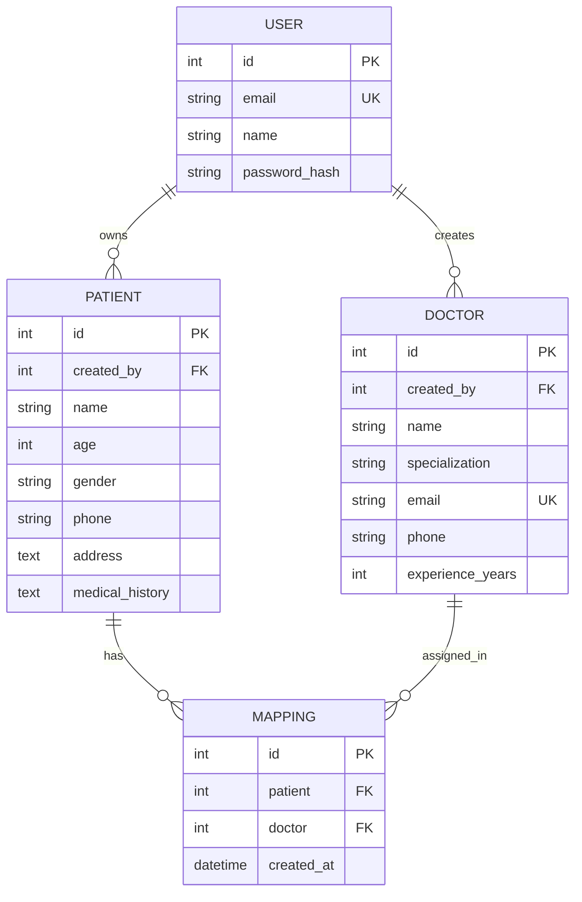
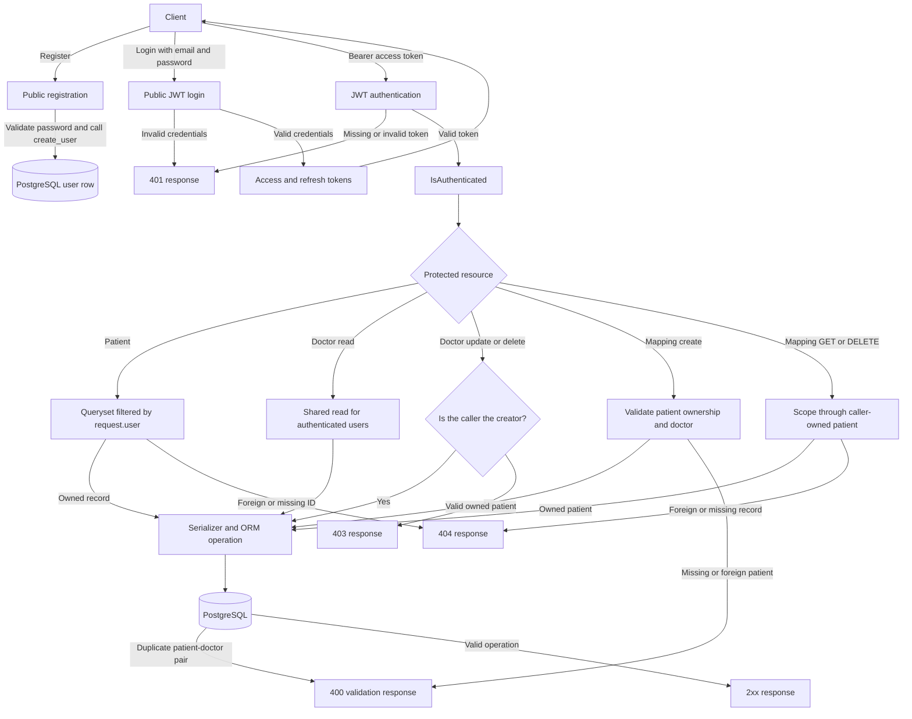

# MedAxis

A security-focused, assignment-scope healthcare backend API built with Django, Django REST Framework, and PostgreSQL. Users authenticate with JWTs, manage their own patient records, read a shared doctor directory, and assign doctors to patients.

> Built as the backend assignment for the WhatBytes Backend Developer Intern role. This project does not claim healthcare regulatory compliance.

## Table of contents

- [Features](#features)
- [Tech stack](#tech-stack)
- [Project structure](#project-structure)
- [Database design](#database-design)
- [Authentication and authorization](#authentication-and-authorization)
- [Security posture and request flow](#security-posture-and-request-flow)
- [Getting started](#getting-started)
- [Environment variables](#environment-variables)
- [API reference](#api-reference)
- [Example requests](#example-requests)
- [Postman](#postman)
- [Error handling](#error-handling)
- [Running tests](#running-tests)
- [Design decisions and assumptions](#design-decisions-and-assumptions)
- [Limitations and future work](#limitations-and-future-work)

## Features

- Email-based registration and login with JWT access and refresh tokens.
- Owner-scoped patient CRUD; users cannot read or modify another user's patients.
- Shared doctor directory; any authenticated user can read doctors, but only a doctor’s creator can update or delete that doctor.
- Patient-doctor assignment with a database-enforced unique `(patient, doctor)` pair.
- Serializer validation and structured 4xx responses for invalid requests.
- Environment-based secrets and PostgreSQL configuration.
- Django REST Framework tests for authentication, ownership, permissions, validation, missing records, and database integrity.

## Tech stack

| Layer | Technology | Verified version |
|---|---|---|
| Language | Python | 3.12.3 |
| Web framework | Django | 5.2.18 |
| API framework | Django REST Framework | 3.18.3 |
| JWT | djangorestframework-simplejwt | 5.5.1 |
| Database driver | psycopg2-binary | 2.9.13 |
| Configuration | python-decouple | 3.8 |
| Database | PostgreSQL | 16.15 |
| ORM / tests | Django ORM / Django test runner | — |

Direct dependencies are pinned in [`requirements.txt`](requirements.txt).

## Project structure

```text
MedAxis/
├── accounts/          Custom email-based user, registration, authentication tests
├── patients/          Patient model, owner-scoped CRUD, tests
├── doctors/           Doctor model, creator-only mutations, tests
├── mappings/          Patient-doctor assignments, shared route, tests
├── config/            Django settings and root URL configuration
├── manage.py          Django management entry point
├── requirements.txt   Pinned direct dependencies
├── .env.example       Environment-variable template (placeholders only)
├── README.md
└── postman_collection.json
```

## Database design



The mapping model has a database unique constraint on `(patient, doctor)`, preventing duplicate assignments even if concurrent requests pass serializer validation at the same time. Patient and doctor foreign keys on mappings use `CASCADE`, so deleting either related record removes its mappings.

## Authentication and authorization

- The custom user model uses `email` as `USERNAME_FIELD`; usernames are disabled.
- Login returns an access token (60-minute lifetime) and refresh token (1-day lifetime). The API does not expose a token-refresh URL.
- The default permission is `IsAuthenticated`. Only registration and login are public.
- Patient querysets are filtered by the authenticated owner; another user's patient returns 404 to avoid revealing its existence.
- Any authenticated user can read doctors; only the creator may update or delete one. A non-creator receives 403.
- Mapping list results are limited to mappings for the caller's patients. Mapping creation and removal require ownership of the patient.
- Ownership fields such as `created_by` are read-only in serializers and assigned by the server.

## Security posture and request flow

**Assessment for this assignment's scope:** MedAxis has a **solid security baseline for an assignment-sized CRUD API**. It uses explicit authentication, enforces owner/creator rules at the API layer, validates inputs, and backs duplicate-mapping protection with a PostgreSQL constraint. The current 41-test PostgreSQL suite exercises important authentication, isolation, authorization, and validation cases. This is not a penetration test, independent security audit, or production-readiness certification.

### Implemented safeguards

- **Authentication by default:** DRF's default permission is `IsAuthenticated`; only registration and login are public. Protected requests use JWT bearer authentication.
- **Password handling:** Registration applies Django password validators and creates users with `create_user`; the password field is write-only and is not included in registration responses.
- **Patient isolation:** The patient queryset is filtered by `request.user`, and ownership is assigned server-side. A foreign or missing patient detail ID returns 404.
- **Doctor permissions:** Authenticated users can read the shared doctor directory, but only the creator can update or delete a doctor.
- **Mapping isolation:** Lists are restricted to mappings for the caller's patients. Create validates ownership; mapping GET and DELETE scope through caller-owned patients.
- **Validation and database safeguards:** Serializers reject invalid or duplicate inputs with 4xx responses; PostgreSQL enforces a unique `(patient, doctor)` pair and cascades mapping cleanup on deletion.
- **Configuration hygiene:** Secrets and database settings come from environment variables. `.env` is ignored by Git and `.env.example` contains placeholders only.

### Request and security flow



### Security boundaries

The implementation does **not** include rate limiting, multi-factor authentication, an exposed refresh/logout endpoint, refresh-token blacklisting, audit logging, or deployment-specific TLS and monitoring configuration. Before handling real production data, deploy behind HTTPS, review production settings and secrets management, add operational controls, and obtain an appropriate independent security/privacy review. No healthcare regulatory-compliance claim is made.

## Getting started

### Prerequisites

- Python 3.12 (the implementation was tested with Python 3.12.3).
- PostgreSQL (the implementation and tests were verified with PostgreSQL 16.15).
- Git.

### 1. Clone the repository

```bash
git clone https://github.com/Dhyan011/MedAxis.git
cd MedAxis
```

### 2. Create the PostgreSQL role and database

On Ubuntu, install and start PostgreSQL if needed:

```bash
sudo apt-get update
sudo apt-get install postgresql postgresql-client
sudo service postgresql start
```

Open a PostgreSQL shell as the administrative user:

```bash
sudo -u postgres psql
```

At the `psql` prompt, create the role and set its password interactively so it is not written in shell history:

```sql
CREATE ROLE healthcare_app LOGIN CREATEDB;
\password healthcare_app
CREATE DATABASE healthcare_backend OWNER healthcare_app;
\q
```

The role needs `CREATEDB` so Django can create its temporary test database. The values match `.env.example`; you may choose other database names/credentials if you update `.env` accordingly.

### 3. Install dependencies and configure the environment

```bash
python3 -m venv .venv
source .venv/bin/activate
python -m pip install -r requirements.txt
cp .env.example .env
```

Edit `.env` with the PostgreSQL role password and a newly generated Django secret key. Do not commit `.env`. To generate a key locally:

```bash
python -c "from django.core.management.utils import get_random_secret_key; print(get_random_secret_key())"
```

Copy the generated value directly into your local `.env`; do not paste it into source code or documentation.

### 4. Check, migrate, test, and run

From the repository root with the virtual environment active and `.env` configured:

```bash
python manage.py check
python manage.py migrate
python manage.py test
python manage.py runserver
```

The local API is available at `http://127.0.0.1:8000/`. Settings require PostgreSQL; there is no SQLite fallback.

## Environment variables

| Variable | Purpose | Template value |
|---|---|---|
| `SECRET_KEY` | Django signing key; keep private | Placeholder in `.env.example` |
| `DEBUG` | Django debug mode | `False` |
| `ALLOWED_HOSTS` | Comma-separated allowed hosts | `127.0.0.1,localhost` |
| `DB_NAME` | PostgreSQL database name | `healthcare_backend` |
| `DB_USER` | PostgreSQL login role | `healthcare_app` |
| `DB_PASSWORD` | PostgreSQL role password | Placeholder in `.env.example` |
| `DB_HOST` | Database hostname | `127.0.0.1` |
| `DB_PORT` | PostgreSQL port | `5432` |

`python-decouple` loads the local `.env`; environment variables can also be supplied by the deployment environment.

## API reference

Base URL for local development: `http://127.0.0.1:8000`. All routes require a bearer access token except registration and login.

### Authentication

| # | Method | Endpoint | Access |
|---:|---|---|---|
| 1 | POST | `/api/auth/register/` | Public |
| 2 | POST | `/api/auth/login/` | Public |

### Patients

| # | Method | Endpoint | Access |
|---:|---|---|---|
| 3 | POST | `/api/patients/` | Authenticated; owner set server-side |
| 4 | GET | `/api/patients/` | Authenticated; returns caller's patients |
| 5 | GET | `/api/patients/{id}/` | Owner only; otherwise 404 |
| 6 | PUT | `/api/patients/{id}/` | Owner only; otherwise 404 |
| 7 | DELETE | `/api/patients/{id}/` | Owner only; otherwise 404 |

### Doctors

| # | Method | Endpoint | Access |
|---:|---|---|---|
| 8 | POST | `/api/doctors/` | Authenticated; creator set server-side |
| 9 | GET | `/api/doctors/` | Any authenticated user |
| 10 | GET | `/api/doctors/{id}/` | Any authenticated user |
| 11 | PUT | `/api/doctors/{id}/` | Creator only; otherwise 403 |
| 12 | DELETE | `/api/doctors/{id}/` | Creator only; otherwise 403 |

### Patient-doctor mappings

| # | Method | Endpoint | Access |
|---:|---|---|---|
| 13 | POST | `/api/mappings/` | Authenticated; patient must be caller-owned |
| 14 | GET | `/api/mappings/` | Authenticated; caller's patient mappings only |
| 15 | GET | `/api/mappings/{patient_id}/` | Authenticated; owned patient required |
| 16 | DELETE | `/api/mappings/{mapping_id}/` | Authenticated; mapping must belong to caller's patient |

`GET /api/mappings/{id}/` and `DELETE /api/mappings/{id}/` share a URL pattern: on GET the path value is a **patient ID**; on DELETE it is a **mapping ID**.

`PATCH` is also supported for patient and doctor detail routes. `PUT` replaces a resource and requires all writable fields.

## Example requests

The examples use placeholders rather than real credentials or tokens. Replace the angle-bracket placeholders locally. After login, export the returned access token for protected requests:

```bash
BASE_URL=http://127.0.0.1:8000
TOKEN='<access token from login>'
```

### Register

```bash
curl -X POST "$BASE_URL/api/auth/register/" \
  -H 'Content-Type: application/json' \
  -d '{"name":"<name>","email":"<email>","password":"<new password>"}'
```

201 response (password is not returned):

```json
{"id": 1, "name": "<name>", "email": "<normalized-email>"}
```

### Log in

```bash
curl -X POST "$BASE_URL/api/auth/login/" \
  -H 'Content-Type: application/json' \
  -d '{"email":"<email>","password":"<password>"}'
```

200 response:

```json
{"refresh":"<refresh-token>","access":"<access-token>"}
```

### Create a patient

```bash
curl -X POST "$BASE_URL/api/patients/" \
  -H "Authorization: Bearer $TOKEN" -H 'Content-Type: application/json' \
  -d '{"name":"<patient name>","age":30,"gender":"O","phone":"<phone>","address":"<address>","medical_history":""}'
```

### Create a doctor

```bash
curl -X POST "$BASE_URL/api/doctors/" \
  -H "Authorization: Bearer $TOKEN" -H 'Content-Type: application/json' \
  -d '{"name":"<doctor name>","specialization":"<specialization>","email":"<doctor email>","phone":"<phone>","experience_years":8}'
```

### Assign the doctor to the patient

Use the numeric IDs returned by the patient and doctor create responses:

```bash
curl -X POST "$BASE_URL/api/mappings/" \
  -H "Authorization: Bearer $TOKEN" -H 'Content-Type: application/json' \
  -d '{"patient_id":<patient-id>,"doctor_id":<doctor-id>}'
```

### List doctors assigned to a patient and remove a mapping

```bash
# GET takes a patient ID and returns the doctors assigned to that patient.
curl "$BASE_URL/api/mappings/<patient-id>/" -H "Authorization: Bearer $TOKEN"

# DELETE takes a mapping ID, not a patient ID.
curl -X DELETE "$BASE_URL/api/mappings/<mapping-id>/" -H "Authorization: Bearer $TOKEN"
```

## Postman

Import [`postman_collection.json`](postman_collection.json). Set `baseUrl`, `name`, `email`, `password`, and `doctorEmail` in the collection variables. Run **Register** once for a new email, then **Login**; its test script stores the access token in the collection variable `accessToken`. The create-patient, create-doctor, and assign-mapping scripts store `patientId`, `doctorId`, and `mappingId` after successful requests. Use the collection in order so IDs exist before dependent mapping requests. Avoid defining empty environment variables with the same token/ID names, because environment variables take precedence over collection variables. The collection contains no usable credentials or tokens.

## Error handling

Errors are returned as JSON with an appropriate HTTP status.

| Status | Meaning |
|---:|---|
| 400 | Validation error: missing/invalid field, duplicate email, or duplicate mapping |
| 401 | Missing, invalid, or expired token; or invalid login credentials |
| 403 | Authenticated but not permitted (for example, updating another creator's doctor) |
| 404 | Record does not exist or is intentionally hidden by owner scoping |

Patient gender choices are `M`, `F`, and `O`; patient age is limited to 0–130; doctor experience is limited to 0–80 years. These are input-validation bounds, not clinical rules.

## Running tests

```bash
python manage.py check
python manage.py test
```

The suite currently contains 41 tests. Django creates and drops a temporary PostgreSQL test database; the configured role therefore needs `CREATEDB`. Tests cover registration and login, real and invalid JWT access, CRUD and validation, owner isolation, doctor creator permissions, missing records, mapping duplicates and cascades, and database-level uniqueness.

## Design decisions and assumptions

- **Custom user model before initial migrations:** email login is configured from the start instead of attempting a mid-project user-model swap.
- **Patient 404 for other owners:** queryset filtering prevents disclosure of whether a foreign patient's ID exists.
- **Server-controlled ownership:** `created_by` is read-only and assigned from `request.user`.
- **Doctor directory visibility:** authenticated users can read the shared directory, while object permissions restrict edits and deletes to the creator.
- **Mapping ownership and uniqueness:** serializer checks provide clear 4xx responses; the database unique constraint protects against concurrent duplicate requests.
- **Cascade deletes:** removing a patient or doctor removes related mappings, as required by the assignment.
- **Plain-array lists:** pagination was not added because it is outside the assignment's requested behavior.

## Limitations and future work

- No pagination, filtering, or search on list endpoints.
- No logout/token blacklist or token-refresh endpoint; issued tokens expire naturally.
- No rate limiting, role system, frontend, or deployment automation.
- This assignment backend does not claim compliance with HIPAA or other healthcare regulations.

Possible future work, if required, includes OpenAPI schema generation, pagination, search, role-based access control, rate limiting, and audit logging.
